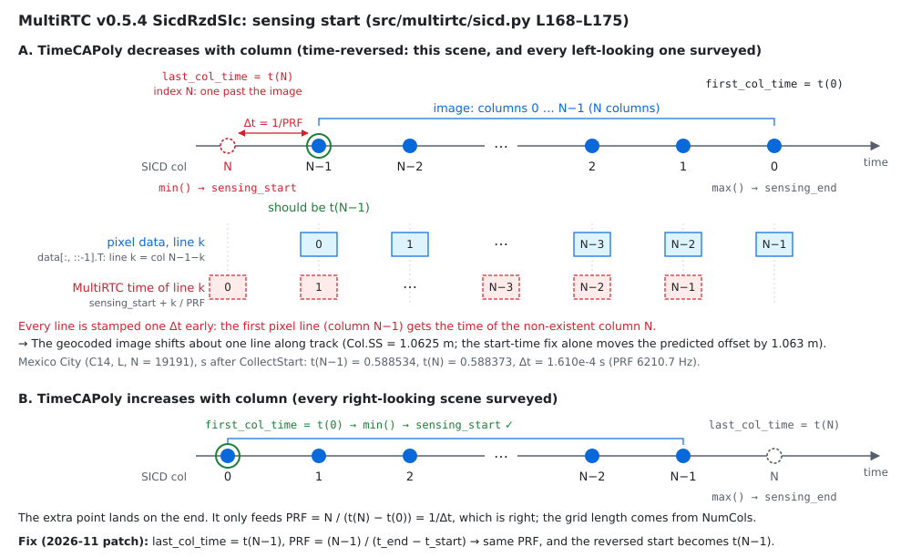
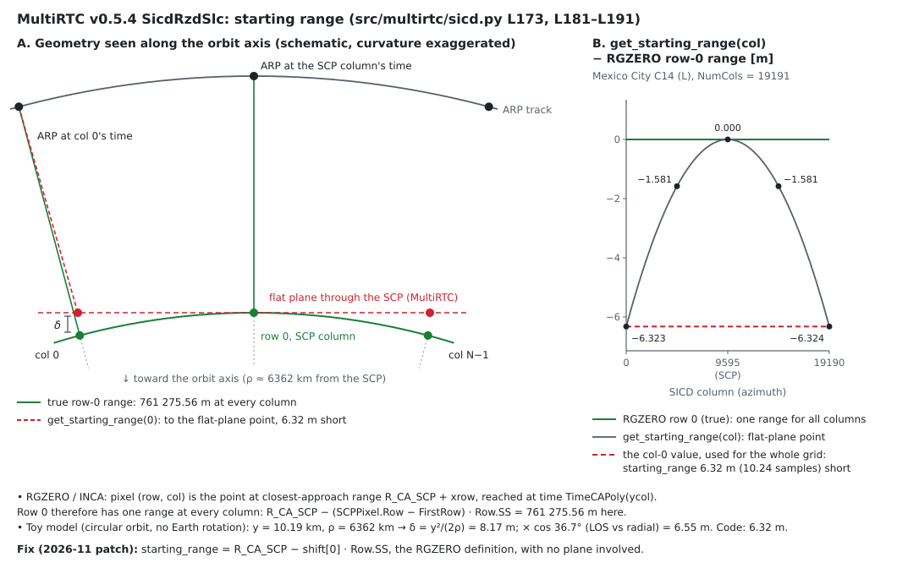

# Capella SICD through isce3 GCOV, cross-checked against MultiRTC

- Date: 2026-09-24
- Host: NucBox EVO T1, 16 CPUs, 93 GB RAM (GCOV and MultiRTC run on CPU).
- isce3: upstream `develop` `2919e1c97` (`0.26.0-dev+2919e1c97`), from-source
  container build — **both** paths below import this build.
- isce3-benchmark: this branch (`feat/sicd-rtc-gcov-compare`, stacked on
  `feat/sicd-beta0-radiometry`; both split out of the closed #57).
- Comparator: MultiRTC v0.5.4, commit `a0edba80a05c923b03ffae378e4a1faf293b0f0f`
  (BSD-3), used read-only (installed `--no-deps` into `data/external/`), with
  sarpy 1.3.59.
- Data: Capella open data, `CAPELLA_C14_SM_SICD_HH_20240626150051_20240626150055`
  (Mexico City, stripmap, left-looking, 19191 × 10631). DEM: Copernicus GLO-30
  (`fetch/fetch_dem_bbox.py`, ellipsoidal) — the same file for both paths.
- Evidence: `artifacts/sicd-capella-rtc-20260924/`.
- Follows `reports/2026-09-capella-sicd-stage-u0.md` (converter, geometry,
  InSAR phase). Tracking: bench#54.
- Added 2026-11-09: the code walk-through and Figures 1–2 in §3.1, with a
  second-order check of the starting-range shortfall
  (`artifacts/multirtc-plane-curvature-20261109/`). No earlier number changed.

## Summary

The SICD → NISAR RSLC converter now has a `--radiometry beta0` option, and the
beta0 product runs through isce3's own RTC workflow (`nisar.workflows.gcov`)
on X-band, metadata included, in 3 min 51 s.

To test that path against an existing downstream implementation, the
same SICD was run through MultiRTC with matched options on the same isce3
build and DEM. Both paths share one geocode/RTC core, so this compares the
**ingest and packaging**, not RTC algorithms, and it says nothing about InSAR
phase.

| MultiRTC variant | map offset vs GCOV, predicted by rdr2geo (along / near-range) | measured by tile correlation | gamma0 within 0.01 dB |
|---|---|---|---|
| stock | −0.91 m / 9.67 m | −1.17 m / 8.84 m | 0.2 % |
| matched (shadow masking off) | −0.91 m / 9.67 m | −1.17 m / 8.84 m | 0.2 % |
| matched + start-time fix | +0.16 m / 9.65 m | +0.15 m / 8.58 m | 0.2 % |
| matched + start-time fix + starting-range fix | −0.006 m / 0.000 m | 0.000 m / 0.000 m | **99.98 %** |

The last column is over the common support. The wavelength difference (§3.1) is
**not** corrected in any variant; with the zero-Doppler LUT used here it does
not reach gamma0 (§3.1, item 3), but it would enter phase use.

With two corrections to MultiRTC's radar grid — applied as runtime
subclasses, its source untouched — the two paths agree closely: over
8,097,578 common valid pixels, 99.9804 % differ by less than 0.01 dB
(p5/p95: −0.001392 / +0.001389 dB); 5,764 edge pixels are valid in MultiRTC
only. The current (biased, §3.2) correlation estimator reports a median
along-track shift of 0.206 mm across 99 tiles; this is not an established
sub-millimetre accuracy bound. Without the corrections, MultiRTC's radar grid
places pixels one azimuth line early and ~9.7 m towards near range (rdr2geo,
§3.2).

The calibrated radar-domain pixels agree before any geocoding: MultiRTC's
complex beta0 raster and the beta0 RSLC image match to 1.2e-7 relative and
6.0e-8 rad over 203,810,191 pixels, with an identical zero pattern.

## 1. The beta0 option

GCOV expects a beta0-calibrated RSLC: it reads
`calibrationInformation/geometry/beta0` (and treats it as all ones) while
writing its metadata, and subtracts the noise LUT in the same radiometry as
|pixel|². The DN product has neither, so the RSLC reader raised `KeyError`.

`--radiometry beta0` (default stays `dn`):

- each pixel × sqrt(`Radiometric/BetaZeroSFPoly`(xrow, ycol)), evaluated at its
  own SICD coordinates through the same flip / transpose / block path as the
  pixels — a real factor, so the phase is untouched;
- noise LUT in beta0 power; `geometry/beta0` = 1; non-finite or non-positive
  factors rejected; provenance string in `processingInformation/inputs`.

In both modes the noise LUT now evaluates the full `NoisePoly`, **clamped to
the image extent**: the LUT grid is padded 20 km in range, where the quadratic
Capella polynomial extrapolates to +190 dB.

| check | result |
|---|---|
| unit tests (`tests/test_sicd_radiometry.py`) | 13 passed: non-constant synthetic polynomial (~100 % variation), flip on/off, blocks of 1/7/64 lines, phase, power ratio, rejection, LUT/image coordinate mapping for both time-slope signs, edge clamping |
| DN mode vs the RSLC the RIFG runs used | 82 datasets identical incl. the image; noise LUT, diagnostics JSON, processingDateTime differ by design |
| beta0 vs DN, 4 Mpx window | power ratio 2.416260e-05 = `BetaZeroSFPoly[0,0]` to float32 rounding; max phase change 5.6e-08 rad |
| noise LUT, beta0 power | −24.1 … −18.6 dB (scene 2: −23.6 … −16.9 dB); DN²: 22.1 … 27.6 dB (was a constant 22.19 dB) |

## 2. isce3 GCOV on X-band

`configs/gcov_capella_mexico_city_20240626.yaml`: input beta0, output gamma0,
area-projection geocode and RTC, `rtc_min_value_db` −30, `dem_upsampling` 2,
biquintic DEM, geo2rdr 1e-7 / 50, `abs_rad_cal` 1, no noise correction,
single-block memory, 5 m in EPSG:32614 — MultiRTC's defaults for a SICD except
shadow masking.

It ran through with warnings only for absent optional metadata (crosstalk,
`inputDataExceptionMask`, `productDoi`, …): 3 min 51 s wall, 5.9 GB RSS (RTC
158 s inside a 221 s geocode). gamma0 median −9.28 dB (p5/p95 −15.6 / +0.9 dB);
geocoded noise −25.9 … −18.7 dB. `identification/radarBand` = X is carried over
from the RSLC. Unlike the InSAR writer, nothing in the GCOV path rejects
X-band. (Its granule-ID code expects 20/40/77/5 MHz bandwidths, but only runs
when a partial granule ID is configured.)

## 3. MultiRTC as a diagnostic comparator

MultiRTC maps an RGZERO SICD onto in-memory isce3 objects (`SicdRzdSlc`) and
calls the same isce3 geocode/RTC functions. It was run with its own defaults
(`stock`) and three controlled variants (`tools/multirtc_capella_rtc.py`).
Stock v0.5.4 is a diagnostic comparator here, not a reference.

### 3.1 Radar grid differences, stock

| quantity | MultiRTC − ours |
|---|---|
| sensing start | −1.006 lines (−1.619e-4 s) |
| starting range | −6.323 m (−10.24 samples) |
| PRF | ratio 1.000000 |
| wavelength | 2.078 cm vs 3.107 cm |
| orbit positions at common times | ≤ 7.3 mm |

Three causes, each read from the pinned source (`src/multirtc/sicd.py`).
Figures 1 and 2 draw the first two; the third is an operator-precedence
slip. The fix for all three is verified in
`reports/2026-11-multirtc-sicd-grid-fix.md`.

1. **Start time** (`sicd.py` L168–L175):

   ```python
   first_col_time = self.source.RMA.INCA.TimeCAPoly(-self.shift[1] * self.spacing[1])
   last_col_time = self.source.RMA.INCA.TimeCAPoly((self.shape[1] - self.shift[1]) * self.spacing[1])
   self.az_reversed = last_col_time < first_col_time
   self.sensing_start = min(first_col_time, last_col_time)
   self.sensing_end = max(first_col_time, last_col_time)
   ...
   self.prf = self.shape[1] / (self.sensing_end - self.sensing_start)
   ```

   The columns are 0 … N−1, but the "last column" time is evaluated at
   index N, one past the image. `min()` and `max()` then take start and end
   whichever way time runs along the columns.

   When `TimeCAPoly` increases with column, the extra point lands on the end
   (Figure 1B). It only feeds the PRF, where `N / (t(N) − t(0))` spans N
   intervals and is exactly 1/Δt for a linear `TimeCAPoly` (as on all 7
   surveyed scenes); the grid length comes from `NumCols`.

   When it decreases, the extra point becomes `sensing_start` (Figure 1A).
   On this scene the slope is −1.5154e-4 s/m: `Col.UVectECF` points against
   the ARP velocity, as on every left-looking scene in the survey below. The
   pixels are flipped (`data[:, ::-1].T`), so isce3 line 0 is column N−1 at
   t(N−1) = 0.588534 s after `CollectStart`. MultiRTC stamps it with
   t(N) = 0.588373 s, the time of a column that does not exist, and every
   later line follows one Δt = 1.610e-4 s early. The PRF stays right
   (6210.7 Hz). Geocoded, this is about one line along track
   (`Col.SS` = 1.0625 m): the start-time fix alone moves the predicted
   along-track offset by 1.063 m, from −0.907 to +0.156 m (Figure 3).

   

   *Figure 1. (A) Time-reversed azimuth: the one-past column N becomes
   `sensing_start`, so each pixel line is stamped one Δt early. (B) Time
   increasing with column: the same point is only the end.*

2. **Starting range** (`sicd.py` L173, L181–L191):

   ```python
   self.starting_range = self.get_starting_range(0)

   def get_starting_range(self, col: int) -> float:
       ycol = (col - self.shift[1]) * self.spacing[1]
       xrow = -self.shift[0] * self.spacing[0]  # fixing to first row
       inca_time = self.source.RMA.INCA.TimeCAPoly(ycol)
       arp_pos = self.arp_pos_poly(inca_time)
       row_offset = self.source.Grid.Row.UVectECF.get_array() * xrow
       col_offset = self.source.Grid.Col.UVectECF.get_array() * ycol
       grid_pos = self.source.GeoData.SCP.ECF.get_array() + row_offset + col_offset
       starting_range = np.linalg.norm(arp_pos - grid_pos)
       return starting_range
   ```

   In an RGZERO / INCA grid, pixel (row, col) is the point at closest-approach
   range `R_CA_SCP + xrow`, reached at time `TimeCAPoly(ycol)`. The SICD grid
   already is a range × zero-Doppler-time grid, and row 0 has one range at
   every column: `R_CA_SCP − (SCPPixel.Row − FirstRow) × Row.SS`,
   761 275.56 m here.

   `get_starting_range` instead treats (xrow, ycol) as Cartesian coordinates
   on the plane through the SCP spanned by `Row.UVectECF` and `Col.UVectECF`:
   the slant plane, with `Row.UVectECF` along the line of sight and
   `Col.UVectECF` along the ARP's direction of motion. It measures from the ARP
   at the column's time to that plane point. At the SCP column the plane point
   lies on the line of sight (`Row.UVectECF` · line of sight = 1 to within
   2e-16), so the distance is exact. Away from it the ARP and the plane point
   drift apart, and the distance comes out short (Figure 2):

   | SICD column (ycol) | MultiRTC − RGZERO row-0 range |
   |---|---|
   | 0 (−10.2 km) | −6.323 m |
   | 4797 (−5.1 km) | −1.581 m |
   | 9595 (SCP) | +0.000 m |
   | 14393 (+5.1 km) | −1.581 m |
   | 19190 (+10.2 km) | −6.324 m |

   The shortfall grows with the square of the along-track distance (×4 from
   5.1 to 10.2 km). Expanding the code's own distance to second order about
   the SCP column (`tools/multirtc_plane_curvature.py`) splits it into two
   terms. Both come from the SICD's ECF `ARPPoly` and `TimeCAPoly`; no Earth
   model enters either the code's value or the RGZERO range it is compared
   with.

   - **The ARP falls toward the scene.** Between the SCP column and column 0
     lie Δt = 1.545 s. The ARP's ECF acceleration has a component of
     5.80 m/s² along the line of sight toward the scene, so at column 0 the
     ARP is ½ · 5.80 · 1.545² = 6.92 m closer to the scene than a straight
     track would put it. The flat plane does not follow the orbit's curvature.
   - **The ARP outruns the plane point.** The ARP moves 1.093 m along track
     per metre of the plane line (`TimeCAPoly` slope × ARP speed). At column 0 it is
     therefore 0.093 × 10.19 km = 952 m farther along track than the plane
     point, which lengthens the distance by 952² / (2 × 761 276 m) = 0.60 m.

   Together they give −6.32 m, against −6.323 m from the code. On all 7
   surveyed scenes the expansion matches the code to within 0.4 mm at every
   sampled column (0.99994–1.00005 × at column 0). A circular-orbit,
   non-rotating toy model of the same geometry, kept in the output for
   reference, lands only within 11 % (0.89–1.06 ×): it leaves out the Earth
   rotation and orbit eccentricity that the ECF `ARPPoly` carries.

   The constant offset comes from the next step: `RadarGridParameters` takes
   one starting range, and MultiRTC evaluates it at column 0, an edge column
   where the shortfall is near its largest. The whole grid is therefore 6.32 m
   (10.24 samples) short in range: a uniform shift, not a curved one. At the
   SCP incidence angle of 40.93° that is 6.32 m / sin 40.93° = 9.65 m on the
   ground, matching the 9.65–9.67 m near-range offset predicted by rdr2geo
   (summary table).

   

   *Figure 2. (A) The slant plane through the SCP, not to scale: the ARP
   track bends toward the scene while the flat plane does not, and the ARP
   covers slightly more ground than the plane point. (B) MultiRTC's per-column
   difference on this scene, and the column-0 value it applies to the whole
   grid.*

3. **Wavelength** (`sicd.py` L42):

   ```python
   center_frequency = sicd.RadarCollection.TxFrequency.Min + sicd.RadarCollection.TxFrequency.Max / 2
   ```

   Operator precedence makes this `Min + (Max / 2)`: 14.425 GHz instead of
   9.650 GHz. With the zero-Doppler LUT and area projection used here, the
   wavelength does not reach gamma0, so it does not appear in the table above.
   A control run in `reports/2026-11-multirtc-sicd-grid-fix.md` §4 confirms
   this: restoring the v0.5.4 wavelength in the fixed grid leaves all 8 output
   rasters bit-identical. Phase use and non-zero Doppler were not tested.

Survey: `artifacts/multirtc-grid-survey-20260924/` (7 Capella stripmap
SICDs, metadata only) and `artifacts/multirtc-plane-curvature-20261109/`
(second-order expansion, toy model, and the sign of `Col.UVectECF` against
the ARP velocity: −1 on all 4 left-looking scenes, +1 on all 3 right-looking
ones).

With both geometry fixes, the residual start difference on this scene is
0.93 µs, equal to the nanoseconds of `Timeline/CollectStart` (`…51.301024927`).
They are dropped before MultiRTC sees the value: sarpy 1.3.59 parses
`CollectStart` at microsecond precision by default (`Timeline.py`,
`numpy_datetime_units='us'`), and MultiRTC takes its reference epoch from that.

### 3.2 Geocoded comparison

Support on the shared grid (5817 × 5829 overlap): with both fixes 8,097,578
common pixels, 0 GCOV-only, 5,764 MultiRTC-only (edges). Shadow masking changes
the support by ~100 pixels and nothing else.

Map offsets are reported two ways:

- **predicted**: rdr2geo of 25 pixels through both radar grids with *our*
  orbit and a constant height of 2245 m — a grid-only control, not the exact
  offset of the two outputs (each path also has its own orbit sampling and
  epoch). For the fully fixed variant its −6 mm along-track is the 0.93 µs
  epoch difference evaluated on one orbit; with each path's own orbit the same
  25 points differ by +0.54 mm along track (max ECEF difference 0.54 mm);
- **measured**: phase correlation of 256 × 256 dB tiles (99 tiles).

The correlation estimator (Hann window, parabolic peak) is **biased**, in
both directions: on GCOV tiles shifted by a known amount it recovered
0.2126 px as 0.117 px and 1.40 px as 1.30 px, but 1.9334 px as 1.966 px
(`estimator_bias.txt`). The measured column is therefore a biased estimate,
not a bound. The prediction gives the size of the grid-induced offset, and
the intervention (last row of the summary table) gives the attribution:
removing the two grid differences removes the offset to within what this
estimator can resolve, and the radiometric agreement above follows.

`quicklook_20240626.png`: GCOV gamma0, and MultiRTC − GCOV for the matched and
the fully fixed variant.

## 4. What this does and does not establish

- Established: the beta0 RSLC is accepted by isce3's GCOV workflow on X-band,
  and on this scene its RTC output agrees with that of an independent ingest
  path (MultiRTC's) to the level above once two identified grid differences
  are removed. Together with the earlier report, the same converter feeds
  isce3's InSAR workflow (DN mode) and its RTC workflow (beta0 mode).
- Not established: RTC accuracy against ground truth (both paths share the
  isce3 RTC core); anything about phase (RTC is power); other scenes or
  producers. Scene 2 was converted to beta0 but not run through GCOV.
- The MultiRTC findings are stated for the pinned v0.5.4 on this input. The
  repository has had no merge since 2026-03-07, and nothing has been reported
  upstream.

## 5. Reproduce

```
make capella-convert-beta0     # beta0 RSLCs
make capella-gcov              # isce3 GCOV on 2024-06-26
make multirtc-setup            # pinned MultiRTC + sarpy into data/external (read-only)
make capella-multirtc          # four variants
make capella-rtc-compare       # comparisons -> data/capella_mexico_city/rtc_compare/
make multirtc-grid-survey      # §3.1 radar grid on 7 SICDs, metadata only
make multirtc-plane-curvature  # §3.1 second-order check of the starting-range shortfall
docker compose run --rm dev python -m pytest -q tests/test_sicd_radiometry.py
```
